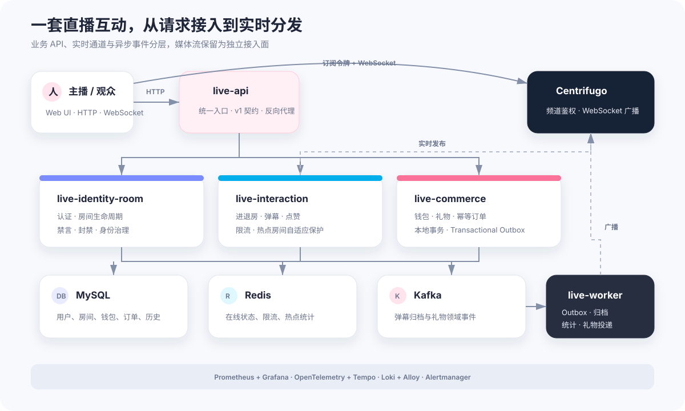
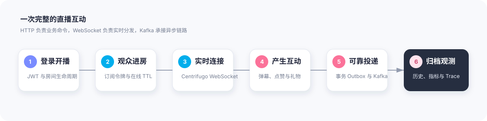
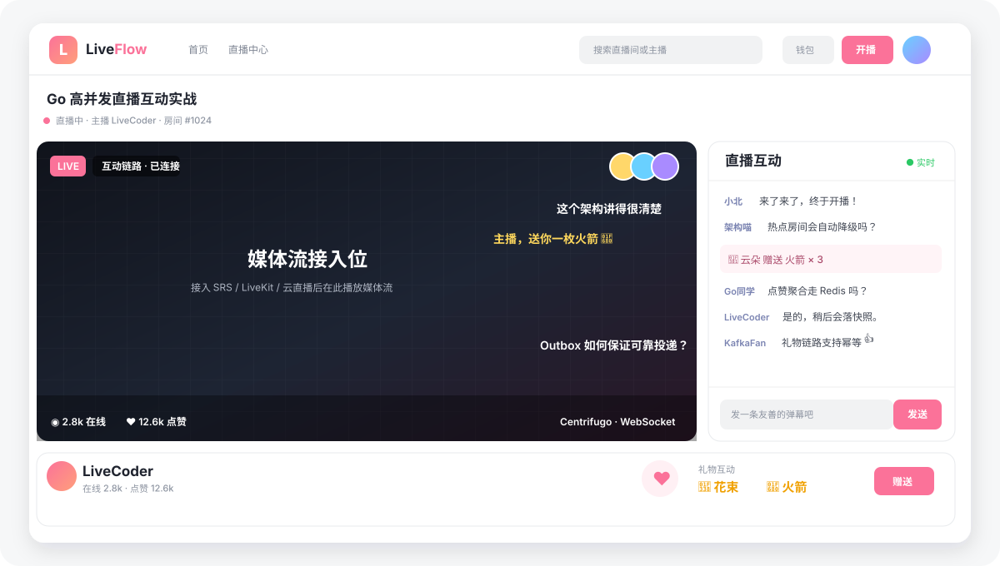

<p align="center">
  
</p>

<p align="center">
  <strong>Live Platform</strong><br/>
  高并发直播互动平台
</p>

<p align="center">
  
  
  
  
  
  
</p>

# Live Platform｜高并发直播互动平台

Live Platform 是一个基于 **Go、Centrifugo、Redis、MySQL 和 Kafka** 的直播互动系统。它覆盖用户认证、开播与进房、实时弹幕、点赞聚合、礼物钱包、房主管理、在线观众和礼物榜，并提供压测、可观测性、故障演练与渐进式微服务拆分方案。

[](#怎么实现的)

<p align="center">
  <a href="#项目是什么">项目是什么</a> ·
  <a href="#界面与互动流程">界面预览</a> ·
  <a href="#优势与特点">优势与特点</a> ·
  <a href="#怎么实现的">怎么实现的</a> ·
  <a href="#拿到项目后怎么用">快速开始</a> ·
  <a href="#压测与可观测性">压测与观测</a>
</p>

> 本项目聚焦直播**互动平面**。视频采集、转码和 CDN 属于可替换的媒体平面；接入 SRS、LiveKit 或云直播服务时，应继续保持两者分离。

## 项目是什么

传统直播 Demo 往往只演示 WebSocket 聊天，Live Platform 则把实时互动放回完整业务链路：用户先完成身份认证和进房鉴权，再通过 HTTP 发起业务命令、通过 WebSocket 接收实时事件；礼物扣款、订单和 Outbox 在同一 MySQL 事务中提交，异步归档与广播由 Kafka 和 Worker 接续完成。

你可以在本地完成一轮完整体验：

| 角色 | 可以做什么 |
| --- | --- |
| 主播 | 创建直播间、开播/停播、查看在线观众和礼物榜、禁言或封禁用户 |
| 观众 | 浏览直播大厅、进入/离开房间、发送弹幕、点赞、充值演示余额并赠送礼物 |
| 平台 | 聚合在线与点赞数据、过滤敏感词、限制异常流量、归档互动历史、输出指标与 Trace |
| 运维 | 查看 Grafana 总览、执行联合压测、注入故障、演练 Kafka 和 Centrifugo HA |



## 界面与互动流程

内置 Web UI 由 `live-api` 直接提供，不需要额外启动前端工程。直播间把媒体流接入位、实时弹幕、礼物榜、在线观众、点赞、钱包和主播治理集中在同一页面。



<p align="center"><sub>界面能力示意，对应仓库内置的实际 Web UI；媒体区域是明确的外部视频流接入位。</sub></p>

实时交互采用四条路径：

- **业务命令走 HTTP**：进房、弹幕、点赞、送礼与治理操作经过身份、限流和业务规则校验。
- **事件分发走 WebSocket**：Centrifugo 推送弹幕、礼物和统计事件，Redis engine 支持实时节点间广播。
- **持久化走异步链路**：弹幕和礼物事件进入 Kafka，由独立 Worker 完成归档、投递和统计聚合。
- **在线状态走 TTL + 显式离房**：正常离房立即清理，异常断线由 Redis TTL 兜底回收。

## 优势与特点

| 特点 | 带来的价值 |
| --- | --- |
| **完整互动闭环** | 从认证、房间、弹幕、点赞到礼物钱包与主播治理，不是孤立的聊天室 Demo |
| **实时通道独立** | HTTP 处理业务命令，Centrifugo 处理 WebSocket 广播，职责与扩容边界清晰 |
| **礼物一致性** | 钱包、订单与 Outbox 同事务提交，幂等键阻止重复扣款，Kafka 不作为 API 就绪依赖 |
| **热点自适应保护** | 按房间热度和扇出速率动态采样弹幕，配合用户限流避免热点流量拖垮全局 |
| **状态可恢复** | 弹幕与成功礼物写入历史，点赞定期快照，在线状态由心跳、离房和 TTL 共同维护 |
| **渐进式服务拆分** | API 契约保持稳定，身份房间、互动、交易服务可配置切流，也可回退到进程内路径 |
| **可观测、可压测** | 内置 Prometheus、Grafana、Tempo、Loki、OpenTelemetry 以及多场景 k6/故障演练脚本 |
| **部署路径完整** | 支持 Docker Compose、本地 HA overlay、Kubernetes 清单与 Argo CD GitOps 入口 |

## 为什么选择 Live Platform

Live Platform 的重点不是模拟播放器，而是展示**高并发互动业务如何在一致性、实时性和可用性之间做工程取舍**。

- **链路真实**：送礼涉及余额校验、事务扣款、幂等订单、Outbox、Kafka 和实时投递，能够观察完整调用链。
- **边界清晰**：互动平面与媒体平面分开；服务间通过版本化内部 API 协作，`live-interaction` 不直接访问身份服务的 MySQL 数据。
- **降级可控**：Kafka 不影响核心 API 就绪，热点房间能够降低广播比例，异步消费者使用租约与去重恢复处理。
- **容量可验证**：仓库保留多轮压测方案、原始报告、优化记录和容量结论，而不是只给出未经验证的性能数字。
- **适合继续演进**：既能以 Compose 一键体验，也保留微服务切流、HA 演练、Kubernetes 和 GitOps 的演进路径。

它适合学习直播互动架构、事件驱动一致性、热点保护、可观测性与容量测试，也可以作为接入真实媒体服务前的互动层原型。它不能直接替代生产级视频云、内容审核、支付结算或多地域容灾系统。

## 怎么实现的

`live-api` 保持客户端 v1 契约，并通过可配置反向代理将请求路由到三个领域服务。同步业务数据进入 MySQL，短周期互动状态进入 Redis，跨服务异步事件进入 Kafka；浏览器通过 Centrifugo 订阅房间流频道和统计频道。

### 服务职责

| 组件 | 职责 |
| --- | --- |
| `live-api` | Web UI 与统一 API 入口，保持外部 v1 契约并代理领域服务 |
| `live-identity-room` | 用户、JWT、房间生命周期、禁言和封禁 |
| `live-interaction` | 进退房、心跳、弹幕、点赞、限流与热点保护 |
| `live-commerce` | 钱包、礼物、幂等订单与 Transactional Outbox |
| `live-worker` | Outbox 发布、礼物实时投递、弹幕归档、统计聚合与点赞快照 |
| Centrifugo | WebSocket 鉴权、房间频道订阅与实时广播 |
| MySQL / Redis / Kafka | 持久化业务数据、承载短状态与限流、传递领域事件 |

钱包、订单和 Outbox 在同一 MySQL 本地事务中提交。Worker 发布成功后推进 Outbox 状态；消费者侧通过事件去重和租约降低重复处理影响。具体演进状态与边界见[微服务化与分布式演进计划](<doc/微服务化与分布式演进计划.md>)。

### 技术栈

| 层次 | 技术选型 | 在项目中的用途 |
| --- | --- | --- |
| 应用服务 | Go 1.25 | API、领域服务、Worker、迁移与压测工具 |
| 实时通信 | Centrifugo 6、WebSocket | 连接管理、频道鉴权、弹幕/礼物/统计广播 |
| 业务存储 | MySQL 8.4 | 用户、房间、钱包、订单、Outbox 与互动历史 |
| 实时状态 | Redis 7.4 | 在线观众、点赞聚合、限流、热点状态和 Centrifugo engine |
| 事件流 | Kafka 4 | 弹幕归档、礼物投递和领域事件解耦 |
| 可观测性 | Prometheus、Grafana、OpenTelemetry、Tempo、Loki、Alloy | 指标、看板、Trace、日志与告警 |
| 部署 | Docker Compose、Kubernetes、Argo CD | 本地环境、HA 演练和 GitOps 入口 |
| 压测 | k6、自研 Go 工具、Shell/Python 脚本 | 连接、热点弹幕、点赞、礼物、故障与系统联合压测 |

### 工程目录

```text
cmd/                 API、领域服务、Worker 与迁移程序入口
internal/            认证、房间、互动、交易、消息和可观测性实现
webui/               内嵌直播大厅、直播间和主播工作台
migrations/          带 checksum 与 advisory lock 的 MySQL 迁移
configs/             Centrifugo 配置
deployments/         Grafana、Prometheus、Tempo、Loki 等本地部署配置
deploy/k8s/           Kubernetes、HA 本地演练与 Argo CD 清单
scripts/             冒烟、压测、故障注入和发布记录工具
benchmark/           压测方法、真实结果、优化记录与容量结论
doc/                 详细设计、协议契约、运维手册与 AI-SRE 资料
front_con/demo/         README 使用的可维护 SVG 图示
```

## 拿到项目后怎么用

推荐直接用 Docker Compose 启动完整环境。前置条件只有 Docker Engine/Desktop 与 Compose v2；本机 Go 工具链仅在直接运行测试或开发服务时需要，版本以 [`go.mod`](go.mod) 为准。

### 1. 启动完整环境

```bash
git clone <your-repository-url>
cd live-platform
make compose-up
```

首次构建和各基础设施健康检查需要一些时间。启动完成后访问：

| 服务 | 地址 | 用途 |
| --- | --- | --- |
| LiveFlow Web / API | [http://localhost:8080/](http://localhost:8080/) | 注册、开播、进房和互动 |
| Centrifugo | [http://localhost:8000/](http://localhost:8000/) | WebSocket 实时接入 |
| Worker 指标 | [http://localhost:19090/](http://localhost:19090/) | Worker 健康检查与指标 |
| Prometheus | [http://localhost:19091/](http://localhost:19091/) | 指标查询 |
| Grafana | [http://localhost:3000/](http://localhost:3000/) | 综合监控总览 |

Kafka 默认发布到宿主机 `localhost:19092`，OTLP gRPC/HTTP 默认发布到 `localhost:14317` / `localhost:14318`。可通过 `KAFKA_HOST_PORT`、`WORKER_HOST_PORT`、`PROMETHEUS_HOST_PORT`、`OTEL_GRPC_HOST_PORT` 和 `OTEL_HTTP_HOST_PORT` 覆盖宿主机端口，容器间通信端口不受影响。

### 2. 完成第一次直播互动

1. 在首页注册主播账号，进入「直播中心」，创建并开播一个直播间。
2. 使用另一个浏览器或无痕窗口注册观众账号，进入同一房间。
3. 发送弹幕和点赞，打开钱包执行 `Demo +10,000`，再赠送礼物。
4. 回到主播页面查看礼物 Top 3、在线观众，并尝试禁言或封禁操作。
5. 打开 Grafana，观察 HTTP、互动、MySQL、Redis、Kafka/Outbox 和进程资源指标。

开发充值只用于本地演示。生产环境必须将 `ENABLE_DEV_WALLET_CREDIT` 设为 `false`，并替换全部开发密钥。

### 3. 停止环境

```bash
make compose-down
```

该命令保留本地数据。`make compose-reset` 会删除 MySQL、Kafka、Grafana 等 Docker 数据卷并重新创建环境，只在确实需要清空数据时使用。

### 常用命令

```bash
make test                 # 运行全部 Go 与 Python 测试
make vet                  # 运行 go vet
make fmt                  # 格式化 Go 文件
make compose-up           # 启动完整本地环境
make compose-down         # 停止环境并保留数据
make compose-reset        # 删除本地数据卷并重建环境
make compose-ha-up        # 启动三 Broker Kafka + 三副本 Centrifugo
make compose-ha-down      # 停止 HA 演练并删除其数据卷
make smoke-ui             # UI 冒烟测试
make smoke-m8             # M8 本地冒烟测试
make migrate              # 单独执行数据库迁移
make metrics-load         # 启动项目并执行全链路指标压测
make k6-system-load       # 使用 k6 执行多场景系统联合压测
```

## 核心接口

除注册、登录、房间列表、房间详情、历史消息、Top 3 和观众列表外，接口均需要 `Authorization: Bearer <access_token>`。

| 场景 | 接口 |
| --- | --- |
| 注册 / 登录 | `POST /api/v1/auth/register`、`POST /api/v1/auth/login` |
| 直播间 | `GET/POST /api/v1/rooms`、`POST /api/v1/rooms/{room_id}/start` |
| 进房 / 离房 | `POST /api/v1/rooms/{room_id}/join`、`POST /api/v1/rooms/{room_id}/leave` |
| 弹幕 / 点赞 / 礼物 | `POST /api/v1/rooms/{room_id}/danmaku`、`like`、`gifts` |
| 实时令牌 | `POST /api/v1/realtime/token` |
| 历史消息 | `GET /api/v1/rooms/{room_id}/messages?limit=50` |
| 观众榜 / 列表 | `GET /api/v1/rooms/{room_id}/top-viewers`、`viewers` |
| 钱包 | `GET /api/v1/wallet`、`GET /api/v1/wallet/transactions` |

送礼必须携带唯一的 `Idempotency-Key` 请求头。单次礼物数量、用户限流和钱包余额均由后端校验。完整 HTTP、实时频道和 Kafka 事件契约见 [`doc/contracts/`](doc/contracts/README.md)。

## 配置

本地默认配置位于 [`docker-compose.yml`](docker-compose.yml)。常用变量：

| 变量 | 说明 |
| --- | --- |
| `MYSQL_DSN` | MySQL 连接串 |
| `REDIS_ADDR` / `REDIS_URL` | Redis 地址或 `redis://` / `rediss://` URL |
| `KAFKA_BROKERS` | Kafka Broker 列表 |
| `AUTH_JWT_SECRET` | 应用 JWT 密钥 |
| `CENTRIFUGO_API_KEY` / `CENTRIFUGO_TOKEN_SECRET` | Centrifugo 服务端与令牌密钥 |
| `VIEWER_TTL` | 观众在线 TTL；显式离房会立即清理 |
| `ENABLE_DEV_WALLET_CREDIT` | 开发钱包充值开关；生产环境必须为 `false` |

服务路由变量为 `COMMERCE_BASE_URL`、`INTERACTION_BASE_URL` 与 `IDENTITY_ROOM_BASE_URL`。它们为空时，`live-api` 回退到进程内处理路径；Docker 默认值会路由到对应内部服务，适合渐进式切流与回滚。

生产环境必须替换全部开发密钥，并关闭开发充值接口；详见[安全说明](SECURITY.md)。

## 压测与可观测性

Grafana 的 **Live Platform · 综合监控总览** 按服务状态、请求性能、直播互动、MySQL、Redis、Kafka/Outbox 和进程资源分区。Prometheus 抓取全部应用服务以及 Centrifugo、MySQL Exporter、Redis Exporter 和 Kafka Exporter；Trace 通过 OpenTelemetry Collector 写入 Tempo，容器日志经 Alloy 写入 Loki。

`make metrics-load` 会检查 API、Worker、Prometheus、Grafana 和 Centrifugo；环境未就绪时自动执行 `docker compose up -d --build`。随后它创建独立测试房间和用户，并发产生 HTTP、弹幕、点赞、礼物、治理、WebSocket、Kafka/Outbox 流量，最后通过 Prometheus API 验证看板依赖的指标。报告写入 `reports/metrics-load/<run_id>/`。

`make k6-system-load` 使用 k6 的 `constant-arrival-rate` 与 `constant-vus` executor，同时模拟房间浏览、观众心跳、弹幕、点赞、礼物和 Centrifugo WebSocket 订阅。默认持续 30 秒，门禁为请求失败率低于 1%、全局 P95 小于 500ms、P99 小于 1s、业务成功率高于 99%，且无 dropped iterations。报告写入 `reports/k6-system/<run_id>/`。

常用负载参数可通过 `DURATION`、`USERS`、`READ_RATE`、`DANMAKU_RATE`、`LIKE_RATE`、`GIFT_RATE`、`WS_CLIENTS` 或对应 `LOAD_*` 变量覆盖。更细的热点房间、慢消费者、连接、点赞、礼物与故障演练使用 `make m7-*` 命令；方法、真实结果和容量结论位于 [`benchmark/`](benchmark/README.md)。

## Docker HA、Kubernetes 与 GitOps

常规 Compose 是单机开发环境。若需要演练 Kafka Broker 故障和多副本实时接入，运行：

```bash
make compose-ha-up
```

该 overlay 使用三节点 KRaft Kafka（RF=3、`min.insync.replicas=2`）和三副本 Centrifugo，WebSocket 统一经 `centrifugo-gateway` 的 `localhost:8000` 访问。它仍运行在单一 Docker 宿主机，Redis/MySQL 也仍为单机，因此不能作为生产 HA 结论。详见 [Docker 本地 HA 演练](<doc/operations/Docker本地HA演练.md>)。

Kubernetes 多节点本地演练文件位于 [`deploy/k8s/ha-local`](deploy/k8s/ha-local/README.md)。当前 GitOps 入口为 Argo CD Application `live-platform-demo`，指向 `deploy/k8s/overlays/demo`；该 overlay 当前仅管理 SealedSecret，不能将历史残留工作负载误认为其期望状态。部署前执行：

```bash
make m8-k8s-validate
make gitops-demo-preflight
```

详细操作见 [Kubernetes 说明](deploy/k8s/README.md) 和 [GitOps 运维手册](doc/operations/runbook.md)。

## AI-SRE 知识与发布关联

供 AI-SRE Copilot 导入的服务目录和 Runbook 位于 [`doc/ai-sre/catalog.json`](doc/ai-sre/catalog.json)。部署成功切流后，用同一个 CI run id 为每个变更服务记录发布事件：

```bash
make record-release ARGS='--service live-api --version v1.2.3 --revision <git-sha> --environment production --release-id <ci-run-id> --source github-actions'
```

事件保存在本地 `reports/releases.jsonl`，相同 `release-id + service` 可幂等重试。该文件属于运行数据且被 Git 忽略，应由部署环境持久化，并只读挂载给 Copilot。

## 排障提示

- **实时连接失败**：检查 `http://localhost:8000/health`、`live-interaction`、`centrifugo-gateway` 和 Centrifugo 日志；HA 演练中 `8000` 由网关占用。
- **弹幕刷新后缺失**：确认 Kafka、`danmaku-consumer` 与 MySQL 正常；实时弹幕可用不代表异步归档已经完成。
- **在线人数不准确**：检查客户端是否调用离房接口；网络强制中断时由 `VIEWER_TTL` 兜底清理。
- **礼物未实时出现**：检查 Kafka、Outbox backlog 与 `gift-consumer`，并确认请求使用了唯一幂等键。

## 文档索引

- [贡献指南](CONTRIBUTING.md)
- [安全说明](SECURITY.md)
- [详细设计](doc/直播互动系统详细设计说明书.md)
- [技术方案](doc/基于%20Centrifugo%20的高并发直播互动系统技术方案书.md)
- [协议契约](doc/contracts/README.md)
- [容量与压测报告](benchmark/README.md)
- [M8 就绪与运行手册](doc/operations/m8-production-readiness.md)
- [Docker 本地 HA 演练](<doc/operations/Docker本地HA演练.md>)
- [微服务细化拆分与边界测试](doc/microservices/README.md)
- [微服务化与分布式演进计划](<doc/微服务化与分布式演进计划.md>)

## 项目边界

本项目不包含真实视频推流、转码、CDN、生产级内容审核、真实支付结算或跨地域灾备。接入这些系统时，应保持媒体平面与互动平面分离，并重新完成目标场景下的安全、容量与故障验证。
